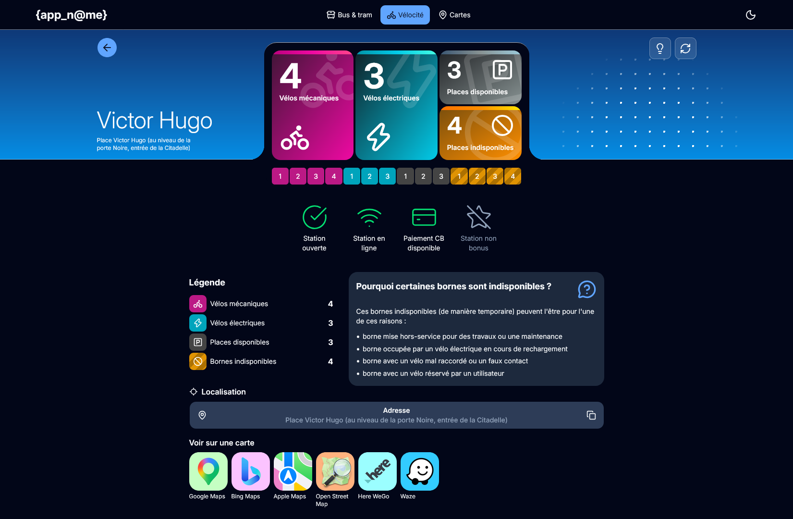

# SuperBus

SuperBus (temporary name) is a mobile app designed to be an alternative to the official "Ginko Mobilités" app. It will provides real-time waiting times for bus and tram services.

[](./static/assets/velocite-station_details.png)

**[WARNING] This project is still under development and many bugs remain unresolved. As this is a proof-of-concept project, the final result may be entirely different.**

## Features

- 🗺️ **Map view** to locate nearby station
- 🚲 **Ginko Vélocité support**: view bike/stand availability in real-time

## Developing

```sh
# Install dependencies
npm install

# Start the development server
npm run dev

# or start the server and open the app in a new browser tab
npm run dev -- --open
```

## Building

To create a production version of your app:

```sh
npm run build
```
