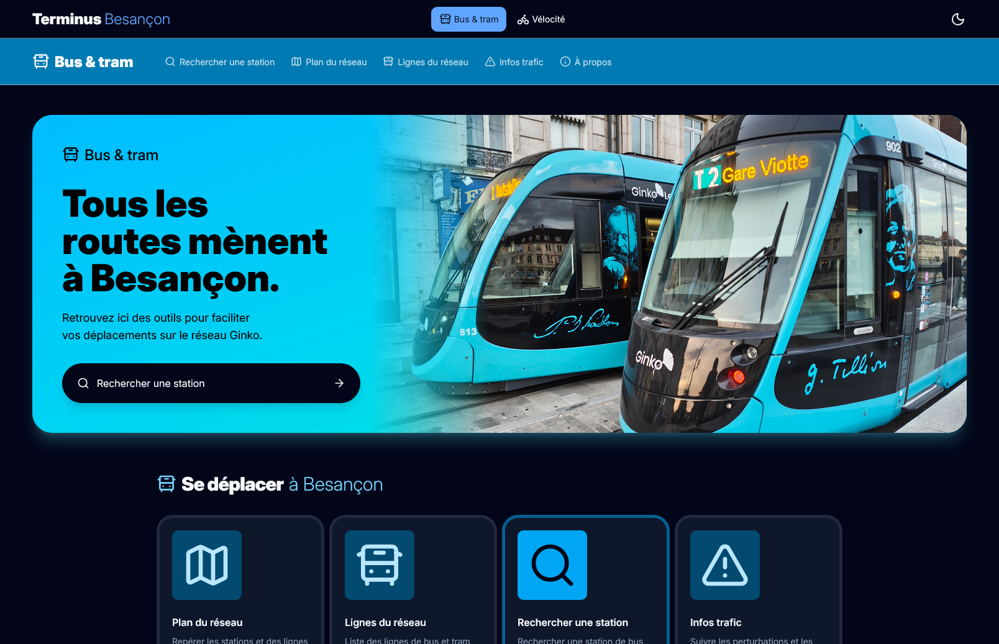

# Terminus

Terminus is a web app designed to be an alternative to the official "Ginko Mobilités" app.

[](./wiki/images/ginko-homepage.png)

**[WARNING] This project is still under development and many bugs remain unresolved. As this is a proof-of-concept project, the final result may be entirely different.**

## Features

At present, only the integration with Ginko Vélocité is fully implemented. Click here to view the [list of features](./wiki/FEATURES.md).

## Developing

```sh
# Install dependencies
npm install

# Start the development server
npm run dev

# or start the server and open the app in a new browser tab
npm run dev -- --open
```

## Deployment

To deploy your app to production, may you use a hosting service, such as Vercel, Netlify, or any other service that supports Node.js applications.
