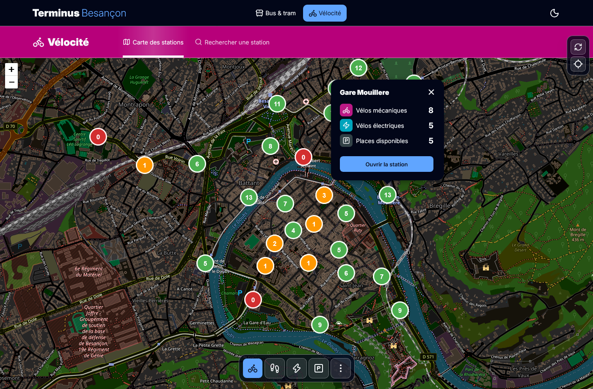
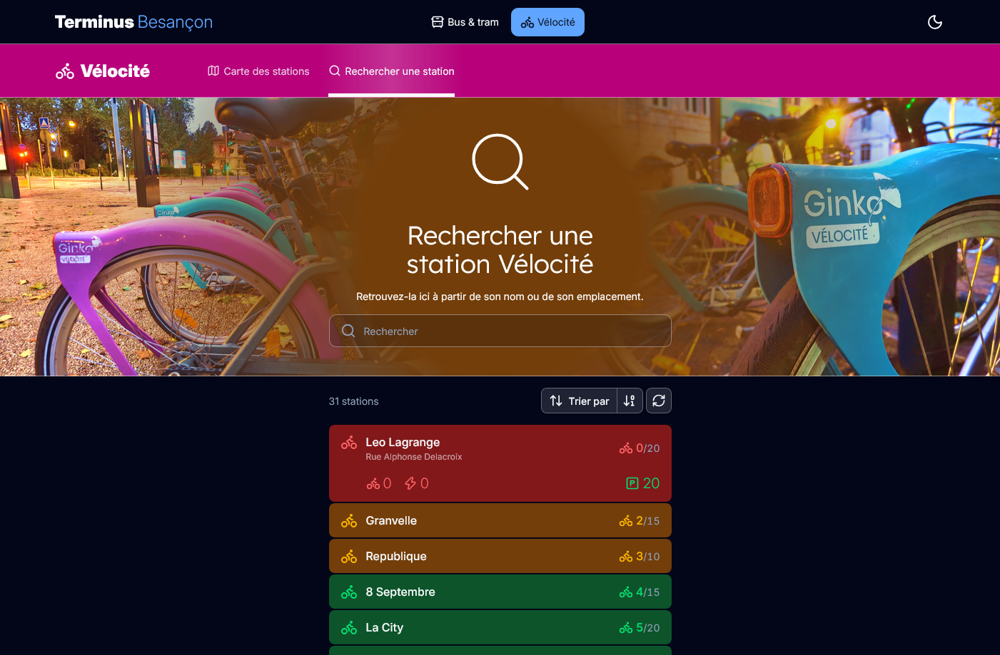
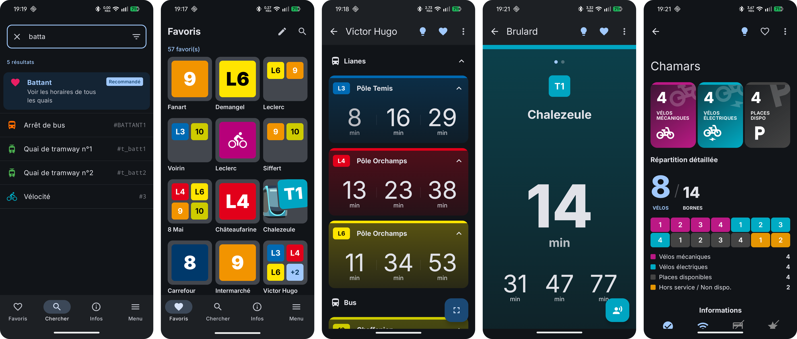

# Features

At present, only the integration with Ginko Vélocité is fully implemented. The following features are available:

## 🗺️ Vélocité Station Map

- Display of Vélocité **station locations**.
- Ability to **display the user's GPS position** on the map.
- Ability to **sort Vélocité stations using color-coded markers**:
  - **Sort by the number of available bikes or docking points**: from red to green through orange.
  - **Sort by station equipment or status**: credit card payment availability, station open status, or connectivity status.
- Display of a quick station summary in a mini popup.
- **Dark mode support** (dark map).

## 🔍 Vélocité Station Search

- Stations can be sorted using 12 sorting options (number of bikes/docks, station open/online status, etc.).
- Highlighting of key information for the first station displayed in the search results (address and summary).
- Real-time results updates.

## 📄 Vélocité Station Details

- **Emphasis on useful station information** (number of available bikes and free docking points).
- **Graphical representation of station occupancy** using a segmented and color-coded progress bar (or grid).
- **Option to keep the screen awake** (prevent automatic sleep mode).

## Ginko Mobilités features

Features related to the Ginko public transport network (the Greater Besançon transit network) are currently being implemented. Eventually, users will be able to:

- Find a network route and identify the stations served by that route.
- View the Ginko network map on an interactive map.
- Monitor traffic and service disruptions.
- Search for a bus or tram stop.
- View waiting times for upcoming bus and tram arrivals.
- Hear waiting times announced through text-to-speech, inspired by the Paris Metro system.

## Major Features to Be Implemented

- Implementation of PWA (Progressive Web App) functionality.
- User account creation system.
- Synchronization of favorite stations across multiple devices.
- Create and deploy a native mobile application.
- Route planning and journey simulation tool.
- Integration of the Mobigo network (regional trains and coaches).
- Integration of the SNCF network (stations and stops in the Greater Besançon area).
- Potential integration with Citiz and FlixBus.
