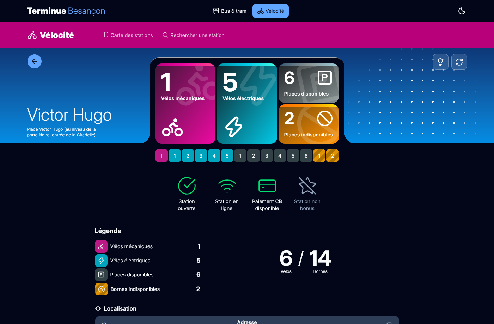
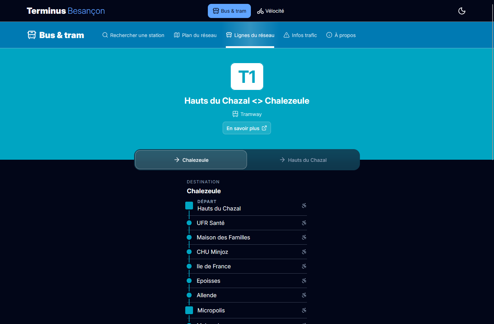

# Fonctionnalités

Pour l’instant seul l’intégration de Ginko Vélocité est complète. Voici la liste des fonctionnalités disponibles :

## 🗺️ Carte des stations

- Affichage des **emplacements des stations Vélocité**.
- Possibilité d'**afficher sa propre position GPS sur la carte**.
- **Tri des stations Vélocité** via une représentation des stations par des pastilles colorées :
  - **Trier par le nombre de vélos disponibles ou de points d'ancrage** : du rouge au vert en passant par l'orange.
  - **Trier par l'équipement ou le statut de la station** : disponibilité du paiement par carte bancaire, statut d'ouverture de la station ou statut de connectivité.
- Affichage d'un récapitulatif de la station dans une mini-popup.
- **Prise en charge du mode sombre** avec une carte sombre.

## 🔍 Recherche de stations Vélocité

- Tri des stations possible via 12 options de tri (quantité de vélos/places, station ouverte/en ligne, etc.)
- Mise en avant des informations clés de la 1ère station affichée dans les résultats de recherche.
- Mise à jour des données en temps réel (nb de vélos, places, etc.).

## 📄 Détails d'une station Vélocité

- **Mise en évidence des infos pertinentes de la station** (nombre de vélos disponibles et bornes libres).
- **Représentation graphique de l'occupation de la station** à l'aide d'une barre de progression segmentée et colorée (ou d'une grille).
- **Option de maintien de l'écran allumé** (pour empêcher la mise en veille automatique du système).

## Intégration de Ginko Mobilités

Les fonctionnalités liées au réseau de transport en commun Ginko (le réseau de transport du Grand Besançon) sont actuellement en cours d'implémentation. À terme, il sera possible de :

- Retrouver une ligne du réseau et repérer les stations desservies par cette ligne ;
- Consulter le plan des lignes du réseau Ginko sur une carte interactive ;
- Suivre le trafic et les perturbations du service ;
- Rechercher un arrêt de bus ou de tram avec des filtres ;
- Consulter les temps d'attente pour les prochains passages de bus et de tram ;
- Annonce des temps d'attente via la synthèse vocale, inspirée du système du métro parisien ([Ecran PANAM/SIEL](https://youtu.be/M3j0xNkYBy0?si=6MJ926puqFzxaYgx&t=5)) ;

## Fonctionnalités majeures à mettre en œuvre

- Implémentation des mécanismes PWA (Progressive Web App) ;
- Création et déploiement d'une application mobile native ;
- Mise en place d'un système de compte utilisateur ;
- Synchronisation des stations favorites sur plusieurs appareils ;
- Outil de planification d'itinéraire et de simulation de trajet ;
- Intégration du réseau Mobigo (TER & cars) ;
- Intégration du réseau SNCF (gares et haltes ferroviaires dans le Grand Besançon) ;
- Intégration potentielle avec Citiz et FlixBus ;
